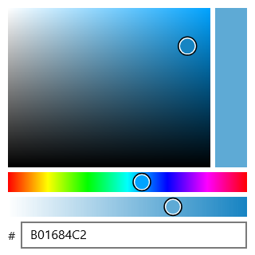

# Spillman.Xamarin.Forms.ColorPicker

[](https://www.nuget.org/packages/Spillman.Xamarin.Forms.ColorPicker)

An HSV color picker for Xamarin.Forms, with an alpha slider and hex entry. Drawn with SkiaSharp, so it looks and behaves the same on every platform.



[Short video of it in use](https://www.youtube.com/watch?v=A5GesThEogo)

## Install

Into your shared project and each platform project:

```
dotnet add package Spillman.Xamarin.Forms.ColorPicker
dotnet add package SkiaSharp
dotnet add package SkiaSharp.Views.Forms
```

## Use

Drop the view in and give it a `ColorPickerViewModel` as its binding context:

```xml
<ContentPage
    xmlns="http://xamarin.com/schemas/2014/forms"
    xmlns:x="http://schemas.microsoft.com/winfx/2009/xaml"
    xmlns:colorPicker="clr-namespace:Spillman.Xamarin.Forms.ColorPicker;assembly=Spillman.Xamarin.Forms.ColorPicker"
    x:Class="Example.MainPage">

    <ContentPage.BindingContext>
        <colorPicker:ColorPickerViewModel />
    </ContentPage.BindingContext>

    <colorPicker:ColorPickerView HorizontalOptions="Center" VerticalOptions="Center" />
</ContentPage>
```

Then read the color off the view model, or hold your own instance and bind to it:

```cs
var viewModel = new ColorPickerViewModel { Color = Color.Rebeccapurple };
viewModel.PropertyChanged += (_, e) =>
{
    if (e.PropertyName == nameof(ColorPickerViewModel.Color))
    {
        Apply(viewModel.Color);
    }
};
```

## ColorPickerViewModel

| Member | Type | Notes |
| --- | --- | --- |
| `Color` | `Xamarin.Forms.Color` | The selected color. Settable — assigning one moves the picker. |
| `SKColor` | `SkiaSharp.SKColor` | The same color, for when you are drawing with Skia anyway. Read-only. |
| `HueColor` | `Color` | The pure hue at full saturation and value, handy for tinting your own chrome. Read-only. |
| `Hex` | `string` | Six hex digits, `RRGGBB`. Alpha is not part of it — that's `A`. Settable; non-hex characters get filtered out as you type. |
| `A` | `byte` | Alpha, 0–255. |
| `H` | `float` | Hue, 0–360. |
| `S` | `float` | Saturation, 0–100. |
| `V` | `float` | Value, 0–100. |
| `IsAlphaEnabled` | `bool` | Set false to hide the alpha slider. Defaults to true. |
| `IsHexEnabled` | `bool` | Set false to hide the hex field. Defaults to true. |

The view model implements `INotifyPropertyChanged`, and every component raises a change for `Color` too, so binding to `Color` alone is enough to track the selection.

## Example app

[`source/Example`](source/Example) is a minimal Xamarin.Forms app with the picker on a page, for Android, iOS, and UWP.

## A note on Xamarin.Forms

Xamarin.Forms reached end of support in May 2024. This package still works against Xamarin.Forms 5, but new apps should be on .NET MAUI, where this control does not run without being ported.

## License

MIT.
